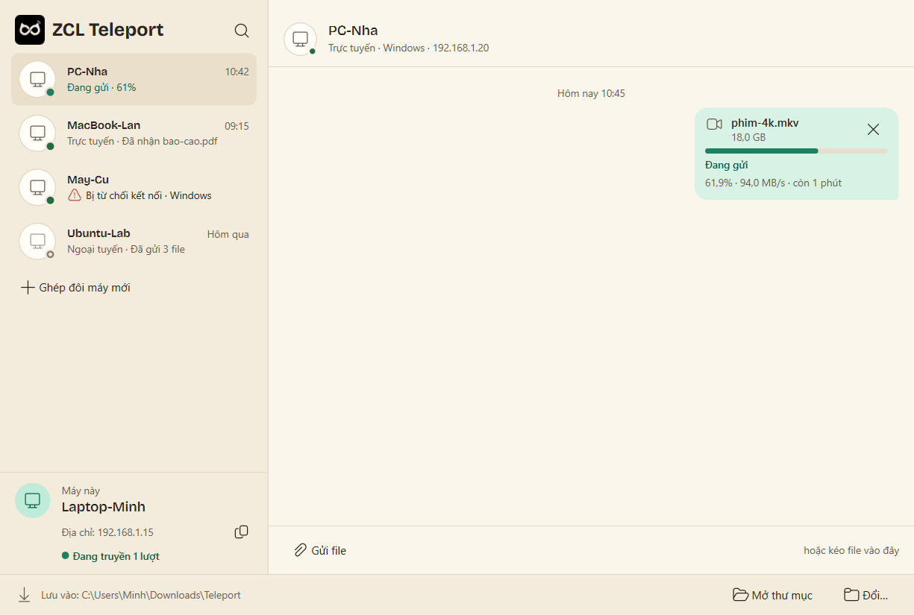

<div align="center">

# 🛰️ ZCL Teleport

### Zero-Cloud LAN Teleport

**Chuyển file nặng hàng chục GB và đồng bộ clipboard giữa các máy tính trong cùng mạng Wi-Fi/LAN.**
**Không cloud · Không tài khoản · Rớt mạng vẫn gửi tiếp.**

[](https://github.com/Nha-Cong-Dong/zero-cloud-lan-teleport/actions/workflows/ci.yml)
[](https://github.com/Nha-Cong-Dong/zero-cloud-lan-teleport/releases)
[](LICENSE)


**[🌐 Trang giới thiệu](https://nha-cong-dong.github.io/teleport-site/)** · **[⬇️ Tải bản thử nghiệm](https://github.com/Nha-Cong-Dong/zero-cloud-lan-teleport/releases)** · **[📖 Tài liệu](docs/README.md)**



</div>

> **In English:** Teleport sends very large files and syncs the clipboard between computers on the same LAN, directly and encrypted, with no cloud, no accounts and no telemetry. Interrupted transfers resume where they stopped. The first test build, `v0.1.0-alpha` (Windows only, unsigned), is on the [Releases](https://github.com/Nha-Cong-Dong/zero-cloud-lan-teleport/releases) page. Product website: [nha-cong-dong.github.io/teleport-site](https://nha-cong-dong.github.io/teleport-site/). The docs are in Vietnamese. Licence: GPL-3.0-or-later.

> [!NOTE]
> **Teleport đang trong giai đoạn thử nghiệm.** Bản đầu tiên là `v0.1.0-alpha`: chỉ cho Windows, chưa ký mã, chưa nên dùng cho dữ liệu quan trọng mà không giữ bản gốc. Bản này có những gì: [docs/CHANGELOG.md](docs/CHANGELOG.md). Tiến độ từng giai đoạn: [docs/ke_hoach.md](docs/ke_hoach.md) mục 5.1. Số đo thực tế: [docs/benchmark.md](docs/benchmark.md).

## Mục lục

- [Vì sao có Teleport?](#vì-sao-có-teleport)
- [Tính năng](#tính-năng)
- [Bắt đầu nhanh](#bắt-đầu-nhanh)
- [Dùng giao diện](#dùng-giao-diện)
- [Dùng dòng lệnh](#dùng-dòng-lệnh)
- [Cách hoạt động](#cách-hoạt-động)
- [Bảo mật & quyền riêng tư](#bảo-mật--quyền-riêng-tư)
- [Câu hỏi thường gặp](#câu-hỏi-thường-gặp)
- [Lộ trình](#lộ-trình)
- [Dành cho nhà phát triển](#dành-cho-nhà-phát-triển)
- [Đóng góp · Bảo mật · Giấy phép](#đóng-góp--bảo-mật--giấy-phép)

## Vì sao có Teleport?

Hai máy tính đặt cạnh nhau, dùng chung một cục Wi-Fi, vậy mà muốn chuyển một file vài GB vẫn phải đi đường vòng:

| Cách thường dùng | Vấn đề |
|---|---|
| **Zalo / Messenger** | Ảnh bị nén, file lớn bị chặn, phải đăng nhập tài khoản cá nhân lên máy lạ |
| **Google Drive** | Tải lên rồi tải về: tốn gấp đôi thời gian và băng thông, dù hai máy ở ngay cạnh nhau |
| **USB** | Phải có USB, cắm, copy, rút, cắm sang máy kia |
| **Chia sẻ thư mục Windows** | Cấu hình quyền phức tạp; rớt mạng là phải copy lại từ đầu |

**Teleport gửi file thẳng từ máy này sang máy kia** qua mạng nội bộ. Dữ liệu không đi qua máy chủ nào. Bốn giá trị cốt lõi: **Zero-Friction** (không tài khoản, không gõ IP), **Zero-Cloud** (chỉ đi trong mạng nội bộ, có mã hóa), **Zero-RAM-Overflow** (file lớn cỡ nào cũng không làm phình bộ nhớ) và **không sợ rớt mạng**. Giải thích, cùng các nguyên tắc sản phẩm: [docs/y_tuong.md](docs/y_tuong.md) mục 3 và mục 6.

## Tính năng

Cột “Alpha” cho biết tính năng đã có trong `v0.1.0-alpha` hay chưa. Tiêu chí chấp nhận của từng tính năng: [docs/mvp.md](docs/mvp.md) mục 5.

| | Tính năng | Mô tả | Alpha |
|---|---|---|---|
| 📡 | **Radar tự tìm máy** (mvp F2) | Mở app là thấy các máy khác đang chạy Teleport trong cùng mạng. Mạng chặn tự tìm thì nhập IP | ✅ |
| 🤝 | **Ghép đôi một lần** (F3) | Lần đầu, hai máy hiện cùng một mã 6 số để bạn xác nhận. Các lần sau tự nhận ra nhau | ✅ |
| 📦 | **Gửi file rất lớn** (F4, F5) | Kéo thả một hoặc nhiều file. Người nhận được hỏi trước (tắt được cho từng máy tin cậy); có tiến độ, tốc độ, nút hủy | ✅ |
| 🔁 | **Tự nối lại** (F6) | Rớt Wi-Fi giữa chừng thì khi có mạng lại chỉ gửi tiếp phần còn thiếu, kể cả khi đã tắt app nhận | ✅ |
| 🧩 | **Kiểm tra toàn vẹn** (F7) | Từng khối và cả file đều được kiểm tra; khối hỏng được gửi lại tự động | ✅ |
| 📋 | **Đồng bộ clipboard** (F8) | Ctrl+C văn bản hay ảnh trên máy này, Ctrl+V trên máy kia. Bật riêng cho từng máy, mặc định tắt | ✅ |
| 🖥️ | **Chạy nền** (F9) | Thu xuống khay hệ thống, luôn sẵn sàng nhận; khởi động cùng Windows | ✅ |
| ⚙️ | **Cài đặt** (F10) | Tên máy, thư mục nhận, thiết bị tin cậy, ẩn máy khỏi máy lạ, giới hạn tốc độ, giao diện sáng/tối | ✅ |
| 🌐 | **Hai ngôn ngữ** (F11) | Tiếng Việt và English | ✅ |
| ⌨️ | **Dòng lệnh** (F12) | Lệnh `teleport` cho người dùng nâng cao và viết script | ✅ |
| 💿 | **Cài đặt & lần chạy đầu** (F1) | Bộ cài, màn lần chạy đầu đặt tên máy và thư mục nhận | ⏳ có màn lần chạy đầu và bộ cài Windows chưa ký mã; macOS, Linux là mục tiêu v1.0 |

<table>
<tr>
<td width="50%"></td>
<td width="50%"></td>
</tr>
<tr>
<td align="center">Tìm máy mới</td>
<td align="center">Hỏi trước khi nhận</td>
</tr>
</table>

## Bắt đầu nhanh

Cần **hai máy Windows 10/11 64-bit (chi tiết: mvp N10) trong cùng một mạng Wi-Fi/LAN**, mỗi máy chạy Teleport.

**1. Tải** từ trang [Release `v0.1.0-alpha`](https://github.com/Nha-Cong-Dong/zero-cloud-lan-teleport/releases/tag/v0.1.0-alpha), chọn một trong ba:

| File | Dành cho |
|---|---|
| `teleport-setup-0.1.0a0-x64.exe` | **Hầu hết mọi người.** Bộ cài giao diện; cài cho cả máy (mặc định) thì tự tạo rule tường lửa |
| `teleport-gui-0.1.0a0-windows-x64.zip` | Giao diện, không cần cài: giải nén, đọc `DOC-TRUOC.txt`, chạy `Teleport.exe` |
| `teleport-cli-0.1.0a0-windows-x64.zip` | Dòng lệnh `teleport`, không cần cài (bộ cài và zip giao diện không có lệnh này) |

Trang Release còn có `SHA256SUMS.txt` để kiểm file tải về, và mã nguồn của thư viện zeroconf đóng kèm (theo giấy phép LGPL của thư viện đó).

**2. Kiểm file tải về** (không bắt buộc): so kết quả của lệnh dưới đây với dòng tương ứng trong `SHA256SUMS.txt`.

```powershell
Get-FileHash .\teleport-setup-0.1.0a0-x64.exe -Algorithm SHA256
```

**3. Chạy.** Bản alpha chưa ký mã nên Windows có thể hiện SmartScreen: bấm **More info** → **Run anyway**. Dùng bản zip, hoặc bộ cài chỉ cho riêng mình, thì lần đầu tường lửa Windows hỏi quyền: cho phép trên mạng **Private**.

**4. Ghép đôi rồi gửi:** làm theo [Dùng giao diện](#dùng-giao-diện).

Muốn chạy từ mã nguồn (Windows, macOS, Linux): xem [Dành cho nhà phát triển](#dành-cho-nhà-phát-triển).

## Dùng giao diện

1. **Mở lần đầu:** cửa sổ hiện tên máy này trong mạng. Tên này hiện với mọi máy trong cùng mạng. Bấm **Bắt đầu**.
2. **Tìm máy mới:** bấm nút kính lúp ở đầu cột trái hoặc **Ghép đôi máy mới**. Radar hiện các máy đang mở Teleport. Không thấy máy kia thì gõ IP của nó (xem bằng `ipconfig`) vào ô **Nhập IP…** rồi bấm **Ghép đôi**.
3. **Ghép đôi (một lần cho mỗi cặp máy):** bấm vào máy chưa ghép. Hai máy cùng hiện một mã 6 số: trùng thì bấm **Trùng khớp** ở **cả hai** máy, khác thì bấm **Không trùng**. Ghép xong, máy đó hiện ở cột trái.
4. **Gửi file:** kéo file thả lên máy đó ở cột trái, hoặc mở cuộc trò chuyện với máy đó rồi thả file vào hay bấm **Gửi file** (Ctrl+O). Chưa gửi được cả thư mục.
5. **Nhận file:** máy nhận hỏi ai gửi, file gì, nặng bao nhiêu, lưu vào đâu. Bấm **Nhận** hoặc **Từ chối**. Mặc định file được lưu vào thư mục `Teleport` trong Tải về (Downloads); trùng tên thì thành `ten (1).ext`, không bao giờ ghi đè file có sẵn.
6. **Theo dõi:** mỗi lượt truyền là một bong bóng trong cuộc trò chuyện, có tiến độ, tốc độ, thời gian còn lại và nút **Hủy**. Rớt Wi-Fi hay tắt app nhận thì bong bóng hiện **Đang nối lại…** và tự chạy tiếp khi hai máy thấy lại nhau. Xong thì hiện **Đã kiểm tra toàn vẹn**.
7. **Chạy nền và thoát:** đóng cửa sổ thì Teleport vẫn chạy ở khay hệ thống và vẫn nhận file. Tắt hẳn: chuột phải biểu tượng ở khay → **Thoát**. Tắt hẳn máy **gửi** giữa chừng thì lượt đó bị hủy, cần gửi lại.
8. **Hủy ghép đôi:** chuột phải vào máy ở cột trái → **Hủy ghép đôi…**.

Các thiết lập khác (tên máy, thư mục nhận, hỏi trước khi nhận, ẩn máy, ngôn ngữ, giao diện) nằm ở **Cài đặt** (nút ⚙ hoặc Ctrl+,).

## Dùng dòng lệnh

Lệnh `teleport` có trong bản zip dòng lệnh và khi cài từ mã nguồn. Trên cùng một thư mục cấu hình, mỗi lúc chỉ một Teleport chạy được: thoát Teleport ở khay trước khi dùng `teleport listen`, `pair`, `receive` hay `send`, và trên máy B nhấn Ctrl+C để dừng `teleport listen` khi ghép xong rồi mới chạy `teleport receive`.

```powershell
# Máy B: chờ ghép đôi (hiện mã 6 số, hỏi xác nhận)
teleport listen
# Máy A: xem các máy trong mạng rồi ghép đôi (theo tên, tiền tố mã máy, hoặc IP)
teleport list
teleport pair PC-Nha
# Máy B: chờ nhận file, hỏi trước mỗi lượt
teleport receive
# Máy A: gửi file
teleport send video.mp4 --to PC-Nha
```

Mọi lệnh và tùy chọn: `teleport --help` và `teleport <lệnh> --help`. Đặc tả hành vi của dòng lệnh: [docs/mvp.md](docs/mvp.md) F12.

## Cách hoạt động

```
   Máy A                                                  Máy B
┌──────────┐  ① Tìm nhau qua mDNS trong mạng nội bộ      ┌──────────┐
│ Teleport │ ◄─────────────────────────────────────────► │ Teleport │
│          │  ② Ghép đôi lần đầu: so mã 6 số             │          │
│          │  ③ TLS 1.3, hai bên xác thực chứng chỉ      │          │
│  file ───┼──► ④ Từng khối, kèm hash, đi thẳng ra đĩa ──┼──► đĩa   │
│          │  ⑤ Rớt mạng → chỉ gửi lại khối còn thiếu    │          │
└──────────┘                                             └──────────┘
             Không máy chủ trung gian · Không cần Internet
```

1. **Khám phá:** mỗi máy tự quảng bá trong mạng nội bộ bằng mDNS, nên máy kia tự hiện ra.
2. **Ghép đôi:** mỗi máy có một chứng chỉ tự ký làm danh tính. Lần đầu, hai máy cùng tính một mã 6 số; người dùng xác nhận mã trùng ở cả hai máy thì hai bên lưu chứng chỉ của nhau.
3. **Kết nối:** TLS 1.3, hai bên đều phải đưa đúng chứng chỉ đã lưu khi ghép đôi. Máy lạ bị từ chối ngay khi bắt tay.
4. **Truyền tải:** file được chia thành khối, mỗi khối mang hash của nó. Bên gửi tự chậm lại khi mạng hay ổ đĩa bên nhận chậm, nên bộ nhớ không phình ra.
5. **Toàn vẹn & nối lại:** bên nhận kiểm từng khối, ghi xuống đĩa và nhớ khối nào đã xong. Nối lại thì chỉ gửi khối còn thiếu. Cuối cùng cả file được đối chiếu lại rồi mới mang tên thật.

Kể bằng lời đơn giản qua một ví dụ: [docs/hieu_du_an.md](docs/hieu_du_an.md). Đặc tả trên dây: [docs/protocol.md](docs/protocol.md).

## Bảo mật & quyền riêng tư

| Mối đe dọa | Cách Teleport xử lý |
|---|---|
| Người cùng Wi-Fi nghe lén | Toàn bộ dữ liệu mã hóa TLS 1.3 |
| Kẻ xấu giả làm máy của bạn | Ghép đôi bằng mã 6 số xác nhận ở cả hai máy; sau đó chỉ chấp nhận đúng chứng chỉ đã lưu |
| Máy lạ gửi file rác | Máy chưa ghép đôi không gửi được gì; mặc định hỏi trước khi nhận |
| File độc hại cố ghi ra ngoài (`..\..\Windows\…`) | Làm sạch tên file, chỉ ghi trong thư mục nhận, không bao giờ ghi đè |
| Lộ mật khẩu qua clipboard | Đồng bộ clipboard mặc định tắt; bỏ qua nội dung mà trình quản lý mật khẩu đánh dấu nhạy cảm |
| Thu thập dữ liệu người dùng | Không telemetry, không tài khoản, không máy chủ, không kết nối Internet |
| Bị nhận ra qua nhiều mạng | Lần chạy đầu nói rõ tên máy hiện với mọi máy trong mạng; có công tắc ẩn máy khỏi máy chưa ghép đôi |

Đầy đủ: [docs/mvp.md](docs/mvp.md) mục 11 và N8, N9. Phát hiện lỗ hổng: báo riêng theo [docs/SECURITY.md](docs/SECURITY.md).

## Câu hỏi thường gặp

<details>
<summary><b>Có cần Internet không?</b></summary>

Không. Teleport chỉ cần các máy cùng một mạng Wi-Fi/LAN; rút dây Internet của router thì việc gửi file vẫn chạy.
</details>

<details>
<summary><b>Hai máy cùng Wi-Fi mà không thấy nhau hay không kết nối được?</b></summary>

Wi-Fi ở quán cà phê, khách sạn hay văn phòng thường bật **cô lập thiết bị** (AP isolation): các máy không nói chuyện được với nhau. Kiểm tra tường lửa đã cho phép Teleport trên mạng **Private**, thử nhập IP thủ công, hoặc phát hotspot từ điện thoại rồi cho hai máy cùng vào.
</details>

<details>
<summary><b>File lớn tới đâu thì gửi được?</b></summary>

Rất lớn: dữ liệu đi thẳng từ ổ đĩa sang ổ đĩa theo từng khối nên RAM không tăng theo cỡ file. Giới hạn cụ thể (cỡ file tối đa, ổ nhận FAT32): [docs/mvp.md](docs/mvp.md) F4. Bộ nhớ khi truyền: mvp N3, số đo ở [docs/benchmark.md](docs/benchmark.md).
</details>

<details>
<summary><b>Tắt máy giữa chừng thì sao?</b></summary>

File đã nhận xong vẫn giữ nguyên. Máy **nhận** tắt hay khởi động lại: mở lại Teleport thì lượt truyền tự chạy tiếp từ chỗ còn thiếu, miễn là máy gửi vẫn đang chờ. Máy **gửi** tắt Teleport: lượt đó bị hủy, máy nhận dọn file tạm, bạn chỉ cần gửi lại. Thời hạn chờ nối lại và các trường hợp riêng: [docs/mvp.md](docs/mvp.md) F6 và mục 8.
</details>

<details>
<summary><b>Có cần cài Teleport trên cả hai máy không?</b></summary>

Có. Chế độ khách qua trình duyệt (cho điện thoại không cài app) nằm trong lộ trình sau v1.0.
</details>

<details>
<summary><b>Có bản cho macOS, Linux, điện thoại không?</b></summary>

Từ mã nguồn, dòng lệnh chạy trên Windows, macOS và Linux; giao diện mới được thử trên Windows. Bộ cài macOS và Linux là mục tiêu của v1.0 (hệ điều hành hỗ trợ: mvp N10). App Android và iOS thuộc lộ trình sau v1.0.
</details>

<details>
<summary><b>Khác gì LocalSend, KDE Connect hay Nearby Share?</b></summary>

Teleport tập trung vào **file cực lớn và đường truyền chập chờn**: nối lại theo từng khối kể cả sau khi tắt app nhận, kiểm tra toàn vẹn cả file. Thêm vào đó là clipboard chung giữa các máy tin cậy, không cần tài khoản ([docs/y_tuong.md](docs/y_tuong.md) mục 8).
</details>

## Lộ trình

Tóm tắt từ [docs/ke_hoach.md](docs/ke_hoach.md) mục 5.1, nơi duy nhất ghi trạng thái giai đoạn; khi hai nơi lệch nhau thì ke_hoach đúng.

| Phiên bản | Nội dung | Trạng thái |
|---|---|---|
| — | Nền tảng; khám phá thiết bị và ghép đôi | ✅ |
| `v0.1.0-alpha` | Gửi file lớn giữa hai máy đã ghép đôi. Bản phát hành gồm mọi thứ đã có lúc gắn tag, cả giao diện Windows | ✅ |
| `v0.2.0-alpha` | Tự nối lại cả sau khi rớt mạng lâu hay tắt app nhận, chỉ gửi phần còn thiếu | ⏳ đã có trong alpha, còn phép đo trên thiết bị thật |
| `v0.3.0-beta` | Giao diện, khay hệ thống, Tiếng Việt / English | ⏳ phần lớn đã có |
| `v0.4.0-beta` | Đồng bộ clipboard | ⏳ code xong; còn một ca ảnh lớn chưa đạt mvp N6, còn đo và thử trên máy thật |
| `v1.0.0` | Bộ cài Windows, macOS, Linux; tài liệu người dùng | ⏳ mới có bộ cài Windows chưa ký |

**Sau v1.0:** app Android, chế độ khách qua trình duyệt, gửi tới nhiều máy cùng lúc, gửi và đồng bộ thư mục, app iOS ([docs/y_tuong.md](docs/y_tuong.md) mục 7).

## Dành cho nhà phát triển

Cần **Python 3.12+**.

```powershell
git clone https://github.com/Nha-Cong-Dong/zero-cloud-lan-teleport.git
cd zero-cloud-lan-teleport
python -m venv .venv
.\.venv\Scripts\Activate.ps1          # macOS/Linux: source .venv/bin/activate
pip install -e ".[dev,gui]"
pytest                                # chạy toàn bộ test
teleport-gui                          # giao diện (hoặc: python -m teleport.ui)
teleport --help                       # dòng lệnh (hoặc: python -m teleport)
```

Nhiều node trên một máy: cho mỗi node một thư mục cấu hình bằng biến môi trường `TELEPORT_HOME` hoặc tùy chọn `--config-dir`.

Code chia tầng `core ← trust ← net ← app ← ui / cli`: tầng dưới không import tầng trên, và `core` là giao thức thuần, không làm I/O, nên phần khó nhất (truyền file, nối lại) được test bằng hàng nghìn kịch bản ngắt mạng mà không cần mạng thật. Quy tắc này được `tests/test_architecture.py` kiểm tự động.

| Tài liệu | Nội dung |
|---|---|
| [docs/README.md](docs/README.md) | Mục lục tài liệu: doc nào là nguồn của thông tin nào, thuật ngữ, quy ước viết |
| [docs/CONTRIBUTING.md](docs/CONTRIBUTING.md) | Cài môi trường, kiểm tra trước Pull Request, nhánh, commit, phát hành |
| [docs/architecture.md](docs/architecture.md) | Phân tầng, mô hình tiến trình, bản đồ module, dữ liệu trên đĩa, cách viết test |
| [docs/protocol.md](docs/protocol.md) | Đặc tả giao thức trên dây |

## Đóng góp · Bảo mật · Giấy phép

- **Đóng góp:** quy trình ở [docs/CONTRIBUTING.md](docs/CONTRIBUTING.md). Báo lỗi hay đề xuất: mở [issue](https://github.com/Nha-Cong-Dong/zero-cloud-lan-teleport/issues).
- **Bảo mật:** báo lỗ hổng theo [docs/SECURITY.md](docs/SECURITY.md), **không** mở issue công khai.
- **Giấy phép:** [GPL-3.0-or-later](LICENSE). Bạn được dùng, sửa và phân phối lại Teleport; bản phân phối đã sửa đổi phải mở mã theo cùng giấy phép.
- **Bản quyền:** Copyright (C) 2026 Nguyễn Hoàng Tùng. Teleport là phần mềm tự do: bạn được phân phối lại và/hoặc sửa đổi theo các điều khoản của Giấy phép Công cộng GNU (GPL) phiên bản 3 hoặc (tùy chọn của bạn) bất kỳ phiên bản nào mới hơn, do Free Software Foundation công bố. Teleport được phân phối với hy vọng hữu ích nhưng **không kèm bất kỳ bảo đảm nào**; chi tiết ở [LICENSE](LICENSE).
