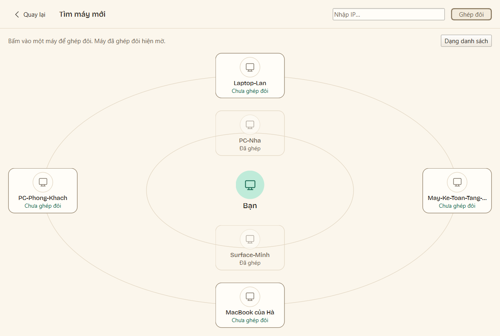
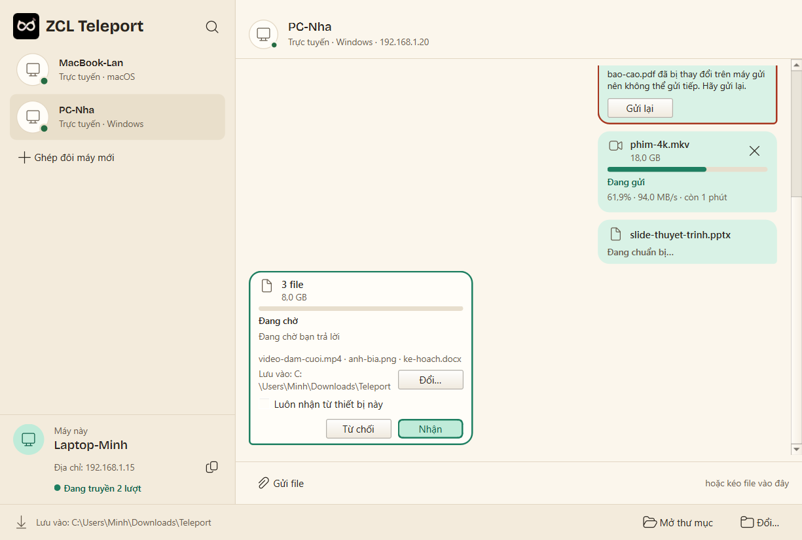

<div align="center">


# ZCL Teleport

**Chuyển file dung lượng lớn và đồng bộ văn bản giữa các máy tính trong cùng mạng nội bộ.**  
**Không trung gian · Không tài khoản · Tự động tiếp tục khi có mạng lại.**

[](https://github.com/Nha-Cong-Dong/zero-cloud-lan-teleport/actions/workflows/ci.yml)
[](https://github.com/Nha-Cong-Dong/zero-cloud-lan-teleport/releases)
[](LICENSE)


**[Trang giới thiệu](https://nha-cong-dong.github.io/teleport-site/)** · **[Tải bản phát hành](https://github.com/Nha-Cong-Dong/zero-cloud-lan-teleport/releases)** · **[Tài liệu chi tiết](docs/README.md)**

</div>

> **Giới thiệu:** ZCL Teleport giúp bạn chuyển các file dung lượng rất lớn và đồng bộ nội dung sao chép giữa các máy tính trong cùng một mạng nội bộ nhanh chóng, bảo mật trực tiếp giữa hai máy mà không đi qua máy chủ bên ngoài hay thu thập thông tin người dùng. Khi đường truyền bị ngắt giữa chừng, ứng dụng tự động gửi tiếp phần còn lại ngay khi kết nối trở lại.

> [!NOTE]
> **Phiên bản chính thức `v1.0.0` đã sẵn sàng.** Nội dung chi tiết các thay đổi: [docs/community/CHANGELOG.md](docs/community/CHANGELOG.md). Lộ trình và tiến độ: [docs/product/ke_hoach.md](docs/product/ke_hoach.md). Kết quả kiểm tra tốc độ thực tế: [docs/technical/benchmark.md](docs/technical/benchmark.md).

---

## Mục Lục

- [Mục Đích Sử Dụng](#mục-đích-sử-dụng)
- [Tính Năng Nổi Bật](#tính-năng-nổi-bật)
- [Bắt Đầu Nhanh](#bắt-đầu-nhanh)
- [Hướng Dẫn Sử Dụng Giao Diện](#hướng-dẫn-sử-dụng-giao-diện)
- [Sử Dụng Dòng Lệnh](#sử-dụng-dòng-lệnh)
- [Cách Thức Hoạt Động](#cách-thức-hoạt-động)
- [An Toàn & Quyền Riêng Tư](#an-toàn--quyền-riêng-tư)
- [Câu Hỏi Thường Gặp](#câu-hỏi-thường-gặp)
- [Lộ Trình Phát Triển](#lộ-trình-phát-triển)
- [Dành Cho Lập Trình Viên](#dành-cho-lập-trình-viên)
- [Đóng Góp · Bảo Mật · Giấy Phép](#đóng-góp--bảo-mật--giấy-phép)

---

## Mục Đích Sử Dụng

Khi hai máy tính ở gần nhau và dùng chung một mạng nội bộ, việc chuyển các tệp tin nặng hàng chục GB thường gặp nhiều phiền phức:

| Cách thông thường | Hạn chế |
|---|---|
| **Ứng dụng nhắn tin** | File bị nén giảm chất lượng, giới hạn kích thước, phải đăng nhập tài khoản |
| **Lưu trữ mạng ngoài** | Tốn hai lần thời gian (tải lên rồi tải về), phụ thuộc tốc độ đường truyền ra ngoài |
| **Ổ nhớ rời (USB)** | Cần thiết bị cắm ngoài, cắm qua cắm lại giữa các máy |
| **Chia sẻ thư mục mặc định** | Cài đặt phức tạp; khi mất mạng đột ngột phải sao chép lại từ đầu |

**Teleport chuyển file trực tiếp từ máy này sang máy kia** qua kết nối nội bộ:
- **Không phức tạp:** Không cần tạo tài khoản, không cần cấu hình địa chỉ rắc rối.
- **Trực tiếp & riêng tư:** Dữ liệu chỉ chạy trong mạng nội bộ của bạn, có mã hóa an toàn.
- **Tiết kiệm bộ nhớ:** File lớn cỡ nào cũng đọc ghi tuần tự theo từng phần, không làm chậm máy.
- **Không sợ rớt mạng:** Mất mạng giữa chừng thì khi có lại sẽ tự động gửi tiếp đúng phần còn thiếu.

Chi tiết nguyên tắc thiết kế: [docs/product/y_tuong.md](docs/product/y_tuong.md).

---

## Tính Năng Nổi Bật

Tiêu chí chi tiết cho từng tính năng: [docs/product/mvp.md](docs/product/mvp.md).

| Tính năng | Mô tả chi tiết | Trạng thái |
|---|---|:---:|
| **Tự tìm máy trong mạng** | Mở ứng dụng là nhìn thấy ngay các máy khác đang mở Teleport gần bạn. Nếu mạng chặn tìm tự động, có thể nhập địa chỉ máy để kết nối. | Hoàn thành |
| **Ghép đôi một lần duy nhất** | Lần đầu kết nối, hai máy hiển thị cùng một mã 6 chữ số để xác nhận. Sau đó hai máy sẽ tự nhận ra nhau. | Hoàn thành |
| **Gửi file dung lượng cực lớn** | Kéo thả một hoặc nhiều file để gửi. Bên nhận luôn được hỏi ý kiến trước khi nhận; hiển thị rõ tốc độ và tiến độ truyền. | Hoàn thành |
| **Tự động nhận tiếp** | Đang gửi mà mất kết nối, khi kết nối lại ứng dụng sẽ gửi tiếp từ vị trí tạm dừng, không gửi lại từ đầu. | Hoàn thành |
| **Kiểm tra tính nguyên vẹn** | Từng phần nhỏ và toàn bộ file đều được kiểm tra khớp hoàn toàn với bản gốc trước khi hoàn tất. | Hoàn thành |
| **Đồng bộ nội dung sao chép** | Sao chép văn bản hoặc ảnh ở máy này có thể dán ngay trên máy kia nếu bạn bật cho phép. Mặc định tắt để đảm bảo riêng tư. | Hoàn thành |
| **Chạy ngầm tiện lợi** | Thu gọn xuống khay hệ thống, luôn sẵn sàng khi có người gửi dữ liệu tới; có thể bật tự khởi động cùng máy. | Hoàn thành |
| **Tùy biến linh hoạt** | Đổi tên máy, đổi thư mục lưu file nhận, ẩn danh khỏi máy lạ, đổi giao diện sáng/tối. | Hoàn thành |
| **Hỗ trợ hai ngôn ngữ** | Tiếng Việt và Tiếng Anh. | Hoàn thành |
| **Hỗ trợ dòng lệnh** | Cung cấp lệnh điều khiển cho người thích thao tác nhanh hoặc tự động hóa công việc. | Hoàn thành |
| **Bộ cài đặt dễ dùng** | Bộ cài đặt tiêu chuẩn cho Windows cùng kịch bản đóng gói đa nền tảng. | Hoàn thành |

<table>
<tr>
<td width="50%"></td>
<td width="50%"></td>
</tr>
<tr>
<td align="center"><b>Tìm máy trong mạng</b></td>
<td align="center"><b>Xác nhận trước khi nhận file</b></td>
</tr>
</table>

---

## Bắt Đầu Nhanh

Cần **hai máy tính Windows 10/11 trong cùng một mạng nội bộ**, mỗi máy mở ứng dụng Teleport.

**1. Tải về** từ trang [Bản phát hành](https://github.com/Nha-Cong-Dong/zero-cloud-lan-teleport/releases):
- `teleport-setup-x64.exe`: Bản cài đặt tự động (khuyên dùng).
- `teleport-gui-windows-x64.zip`: Bản chạy ngay không cần cài đặt.
- `teleport-cli-windows-x64.zip`: Bản dòng lệnh dành cho người dùng kỹ thuật.

**2. Mở ứng dụng:** Khi mở lần đầu, tường lửa có thể hỏi xác nhận, hãy chọn cho phép trên mạng riêng tư (Private).

**3. Ghép đôi và gửi:** Xem hướng dẫn chi tiết ngay bên dưới.

---

## Hướng Dẫn Sử Dụng Giao Diện

1. **Lần đầu khởi động:** Ứng dụng hiển thị tên đại diện của máy bạn. Nhấn **Bắt đầu**.
2. **Tìm máy:** Bấm vào biểu tượng tìm kiếm hoặc nút **Ghép đôi máy mới**. Các máy đang mở ứng dụng sẽ tự động hiện lên trên màn hình.
3. **Ghép đôi (chỉ làm lần đầu):** Bấm vào máy bạn muốn kết nối. Cả hai máy sẽ hiện cùng một mã 6 chữ số: nếu trùng khớp, bấm **Trùng khớp** ở cả hai máy.
4. **Gửi file:** Kéo thả file vào tên máy ở danh sách bên trái hoặc bấm **Gửi file** (phím tắt `Ctrl + O`).
5. **Nhận file:** Bên nhận sẽ nhận được thông báo gồm tên người gửi, tên file và dung lượng. Bấm **Nhận** để đồng ý hoặc **Từ chối**. Mặc định file được lưu vào thư mục `Teleport` trong mục Tải về.
6. **Theo dõi tiến độ:** Tốc độ truyền tải và thời gian dự kiến hiển thị trực quan. Nếu mạng bị gián đoạn, ứng dụng chuyển sang trạng thái chờ và tự động gửi tiếp khi có mạng.
7. **Đóng ứng dụng:** Đóng cửa sổ ứng dụng sẽ thu nhỏ xuống thanh tác vụ để tiếp tục nhận file khi cần. Để tắt hẳn, nhấn chuột phải vào biểu tượng dưới thanh tác vụ và chọn **Thoát**.

---

## Sử Dụng Dòng Lệnh

Lệnh `teleport` dành cho những ai quen thao tác trên cửa sổ lệnh:

```powershell
# Máy B: Mở chế độ chờ ghép đôi
teleport listen

# Máy A: Xem danh sách máy trong mạng và tiến hành ghép đôi
teleport list
teleport pair May-Van-Phong

# Máy B: Sẵn sàng nhận file gửi tới
teleport receive

# Máy A: Gửi tệp sang máy B
teleport send tailieu.zip --to May-Van-Phong
```

Xem đầy đủ trợ giúp với lệnh: `teleport --help`. Đặc tả hành vi dòng lệnh: [docs/product/mvp.md](docs/product/mvp.md).

---

## Cách Thức Hoạt Động

```
   Máy A                                                  Máy B
┌──────────┐  1. Tự động nhận diện nhau trong mạng nội bộ  ┌──────────┐
│ Teleport │ ◄─────────────────────────────────────────► │ Teleport │
│          │  2. Ghép đôi xác nhận mã 6 số một lần duy nhất │          │
│          │  3. Kết nối trực tiếp, mã hóa bảo mật         │          │
│  Tệp tin ┼──► 4. Dữ liệu chia nhỏ truyền thẳng vào ổ đĩa ┼──► Ổ đĩa  │
│          │  5. Ngắt quãng tự động truyền tiếp phần thiếu │          │
└──────────┘                                             └──────────┘
                  Truyền trực tiếp giữa hai máy tính
```

1. **Nhận diện tự động:** Các máy tính tự thông báo sự có mặt trong cùng mạng nội bộ.
2. **Ghép đôi an toàn:** Hai bên đối chiếu mã 6 số để tạo lòng tin và lưu nhớ thông tin nhận diện.
3. **Kết nối mã hóa:** Mọi luồng thông tin truyền qua lại đều được mã hóa trực tiếp giữa hai máy.
4. **Chia nhỏ tệp tin:** Tệp tin lớn được chia thành các phần nhỏ 1 MiB để truyền tuần tự, bảo đảm không gây tràn bộ nhớ máy tính.
5. **Đảm bảo nguyên vẹn:** Máy nhận kiểm tra từng phần nhận được, ghi trực tiếp xuống ổ đĩa. Khi xong toàn bộ mới đổi sang tên tệp chính thức.

Chi tiết giải thích trực quan: [docs/product/hieu_du_an.md](docs/product/hieu_du_an.md). Đặc tả kỹ thuật chi tiết: [docs/technical/protocol.md](docs/technical/protocol.md).

---

## An Toàn & Quyền Riêng Tư

| Tình huống | Cách Teleport bảo vệ bạn |
|---|---|
| **Người khác cùng mạng theo dõi dữ liệu** | Toàn bộ dữ liệu được mã hóa trực tiếp giữa hai máy, người ngoài không thể đọc được. |
| **Máy lạ giả mạo để kết nối** | Bắt buộc phải xác nhận mã 6 số hiển thị trên hai màn hình trước khi gửi dữ liệu. |
| **Nhận file không mong muốn** | Luôn hiển thị câu hỏi xin phép trước khi bắt đầu tải file về máy. |
| **Nguy cơ ghi đè file hệ thống** | Ứng dụng lọc sạch tên tệp, chỉ lưu vào thư mục được chỉ định và không bao giờ ghi đè file có sẵn. |
| **Bảo vệ mật khẩu khi sao chép** | Tính năng đồng bộ nội dung sao chép mặc định tắt; tự động bỏ qua nếu phát hiện nội dung nhạy cảm từ các ứng dụng quản lý mật khẩu. |
| **Không thu thập dữ liệu cá nhân** | Không lưu trữ qua máy chủ trung gian, không gửi bất kỳ thông tin nào ra ngoài mạng nội bộ của bạn. |

Chi tiết chính sách an toàn: [docs/community/SECURITY.md](docs/community/SECURITY.md).

---

## Câu Hỏi Thường Gặp

<details>
<summary><b>Ứng dụng có cần kết nối Internet để hoạt động không?</b></summary>

Không cần. Ứng dụng chỉ cần các máy tính cùng kết nối vào một mạng nội bộ (cùng cắm dây mạng hoặc cùng bắt chung điểm phát sóng). Dù rút dây mạng Internet ra thì việc chuyển file vẫn diễn ra bình thường với tốc độ tối đa của mạng nội bộ.
</details>

<details>
<summary><b>Hai máy tính cùng mạng nhưng không tìm thấy nhau?</b></summary>

Một số điểm phát sóng nơi công cộng có tính năng chặn các máy tính nói chuyện với nhau. Bạn có thể kiểm tra xem tường lửa trên máy đã cho phép ứng dụng hoạt động trên mạng riêng tư chưa, hoặc nhập trực tiếp địa chỉ máy cần kết nối vào ô tìm kiếm.
</details>

<details>
<summary><b>File lớn bao nhiêu thì có thể gửi được?</b></summary>

Ứng dụng có thể gửi các file rất lớn (hàng chục đến hàng trăm GB) một cách ổn định vì dữ liệu được đọc và ghi tuần tự từng phần nhỏ, không gây tốn bộ nhớ máy tính.
</details>

<details>
<summary><b>Nếu đang chuyển mà bị mất mạng hoặc tắt máy thì sao?</b></summary>

Các phần dữ liệu đã nhận được lưu trữ an toàn. Khi máy nhận mở ứng dụng lại và có kết nối, quá trình chuyển sẽ tự động tiếp tục phần còn lại mà không cần phải gửi lại từ đầu.
</details>

<details>
<summary><b>Cần mở ứng dụng trên cả hai máy không?</b></summary>

Có. Cả máy gửi và máy nhận đều cần mở ứng dụng để nhận diện và bắt tay kết nối với nhau.
</details>

---

## Lộ Trình Phát Triển

Tiến độ chi tiết từng giai đoạn được cập nhật tại [docs/product/ke_hoach.md](docs/product/ke_hoach.md).

- **Giai đoạn 1:** Nền tảng kết nối trực tiếp, tìm kiếm máy trong mạng và cơ chế ghép đôi an toàn (Đã hoàn thành).
- **Giai đoạn 2 (`v0.1.0-alpha`):** Chuyển file dung lượng lớn trực tiếp giữa hai máy đã ghép đôi trên Windows (Đã phát hành).
- **Giai đoạn 3:** Hoàn thiện cơ chế tự động gửi tiếp dữ liệu khi ngắt kết nối kéo dài (Đã hoàn thành).
- **Giai đoạn 4:** Hoàn thiện giao diện đồ họa, tối ưu khay hệ thống, ngôn ngữ Tiếng Việt và Tiếng Anh (Đã hoàn thành).
- **Giai đoạn 5:** Hoàn thiện tính năng đồng bộ nội dung sao chép an toàn (Đã hoàn thành).
- **Bản chính thức (`v1.0.0`):** Đóng gói bộ cài đặt tiêu chuẩn, tài liệu người dùng và kịch bản đa nền tảng (Đã hoàn thành).

---

## Dành Cho Lập Trình Viên

Yêu cầu môi trường: **Python 3.12+**.

```powershell
git clone https://github.com/Nha-Cong-Dong/zero-cloud-lan-teleport.git
cd zero-cloud-lan-teleport
python -m venv .venv
.\.venv\Scripts\Activate.ps1
pip install -e ".[dev,gui]"
pytest                                # Chạy kiểm thử tự động
teleport-gui                          # Khởi chạy giao diện đồ họa
teleport --help                       # Khởi chạy dòng lệnh
```

Mã nguồn được phân tầng rõ ràng theo quy tắc `core <- trust <- net <- app <- ui / cli`. Các tầng bên dưới độc lập hoàn toàn với tầng bên trên, giúp việc kiểm thử tự động đạt độ tin cậy cao mà không cần môi trường mạng thực tế.

| Tài liệu tham khảo | Nội dung chi tiết |
|---|---|
| [docs/README.md](docs/README.md) | Bản đồ định hướng toàn bộ tài liệu |
| [docs/community/CONTRIBUTING.md](docs/community/CONTRIBUTING.md) | Quy định đóng góp mã nguồn, kiểm tra chất lượng và phát hành |
| [docs/technical/architecture.md](docs/technical/architecture.md) | Kiến trúc phân tầng mã nguồn, mô hình tiến trình và cấu trúc dữ liệu |
| [docs/technical/protocol.md](docs/technical/protocol.md) | Đặc tả định dạng truyền dữ liệu trực tiếp |

---

## Đóng Góp · Bảo Mật · Giấy Phép

- **Đóng góp:** Xem hướng dẫn tại [docs/community/CONTRIBUTING.md](docs/community/CONTRIBUTING.md).
- **Bảo mật:** Báo cáo vấn đề an toàn theo hướng dẫn tại [docs/community/SECURITY.md](docs/community/SECURITY.md).
- **Giấy phép:** Phần mềm được phát hành theo giấy phép tự do nguồn mở [GPL-3.0-or-later](LICENSE).
- **Tác giả:** Bản quyền (C) 2026 Nguyễn Hoàng Tùng (@Luffyreals).
