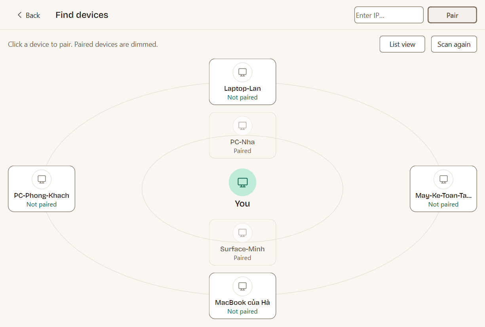
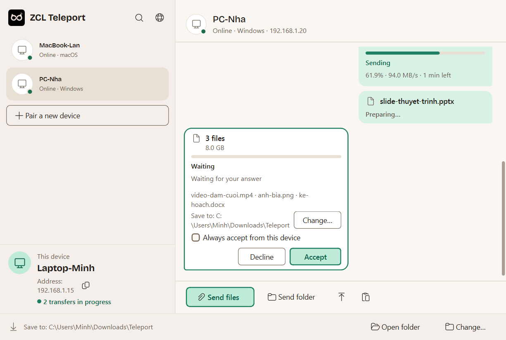
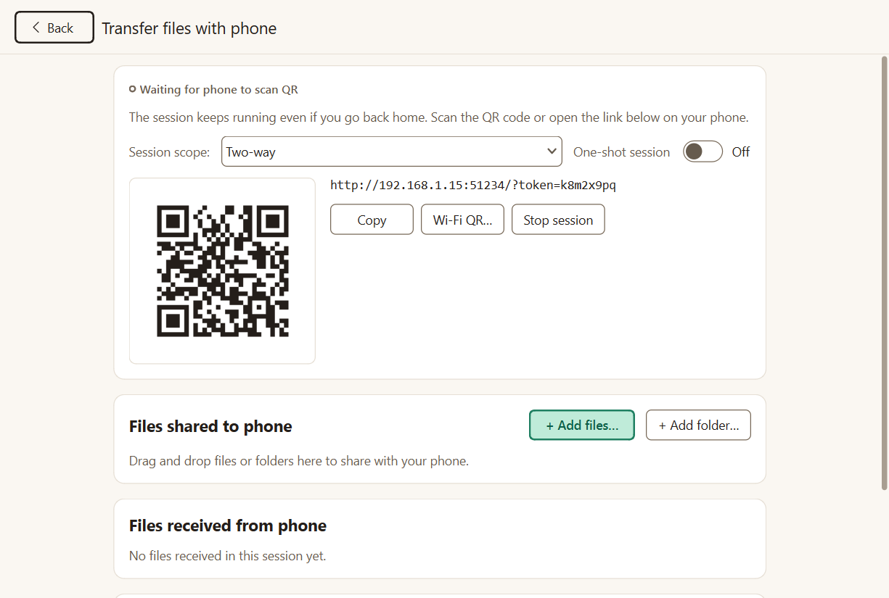
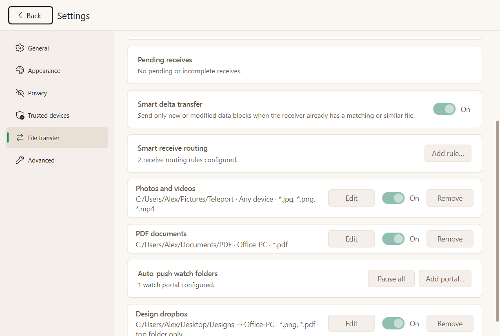

<div align="center">

<p><b>English</b> · <a href="docs/product/README.vi.md">Tiếng Việt</a></p>


# ZCL Teleport

**Send large files and sync clipboard text between computers on the same local network.**  
**Windows · macOS · Linux · No middleman · No accounts · Resumes automatically.**

[](https://github.com/Nha-Cong-Dong/zero-cloud-lan-teleport/actions/workflows/ci.yml)
[](https://github.com/Nha-Cong-Dong/zero-cloud-lan-teleport/releases)

[](LICENSE)

[](https://github.com/sponsors/tungkernel)

**[Website (ZCL Hub)](https://tungkernel.github.io/zcl-hub/)** · **[Download](https://github.com/Nha-Cong-Dong/zero-cloud-lan-teleport/releases)** · **[Documentation](docs/README.md)** · **[Sponsor](https://github.com/sponsors/tungkernel)**

</div>

> **About:** ZCL Teleport moves very large files and shared clipboard content between computers on the same local network. Data goes straight from one machine to the other, encrypted, without passing through any outside server and without collecting any user information. If the connection drops halfway, the app picks up where it stopped as soon as the link is back.

> [!NOTE]
> **Version `v1.8.0` is available** with packages for Windows, macOS and Linux. See what changed in [CHANGELOG.md](docs/community/CHANGELOG.md). Roadmap and progress: [ke_hoach.md](docs/product/ke_hoach.md). Measured speeds: [benchmark.md](docs/technical/benchmark.md). Most internal project documents are written in Vietnamese.

---

## Table of Contents

- [Why Teleport](#why-teleport)
- [Features](#features)
- [Quick Start](#quick-start)
- [Using the App](#using-the-app)
- [Command Line](#command-line)
- [How It Works](#how-it-works)
- [Safety and Privacy](#safety-and-privacy)
- [FAQ](#faq)
- [Roadmap](#roadmap)
- [Support the Project](#support-the-project)
- [For Developers](#for-developers)
- [Contributing, Security, License](#contributing-security-license)

---

## Why Teleport

When two computers sit next to each other on the same network, moving a file of tens of gigabytes is surprisingly annoying:

| Usual approach | Drawback |
|---|---|
| **Messaging apps** | Size limits, recompressed files, a login is required |
| **Cloud storage** | Doubles the time (upload, then download) and depends on your internet speed |
| **USB drives** | You need a drive and have to plug it back and forth |
| **Built-in folder sharing** | Tricky to set up, and a dropped connection means copying again from the start |

**Teleport sends files directly from one machine to the other** over your local network:
- **Simple:** no account to create, no addresses to configure.
- **Direct and private:** data stays inside your network and is encrypted.
- **Light on memory:** files of any size are read and written piece by piece.
- **Safe against dropouts:** if the network goes away, only the missing part is sent once it returns.

### Built for heavy transfers, all in one place

Beyond basic file sending, Teleport combines four capabilities in the same app:

| Capability | What it does |
|---|---|
| **Two-way power-loss resume** | Both sender and receiver keep transfer state on disk. Even if either machine loses power or reboots mid-transfer, sending continues with only the missing blocks once both are back. |
| **Smart delta transfer** | When the receiver already has an older or similar copy of a large file, Teleport only transmits the changed blocks instead of resending the entire file. |
| **Auto-push watch folders & receive routing** | Drop files into a watched folder to send them automatically to a chosen device, and sort incoming files into target folders by file type or sender. |
| **Built-in CLI** | Scriptable `teleport` commands that talk directly to the running background app instead of fighting over ports or locks. |

Design principles: [y_tuong.md](docs/product/y_tuong.md).

---

## Features

Acceptance criteria for every feature: [mvp.md](docs/product/mvp.md).

| Feature | Details | Status |
|---|---|:---:|
| **Automatic device discovery** | Open the app and see other machines running Teleport nearby. If the network blocks discovery, enter the machine's address by hand. | Done |
| **One-time pairing** | On first contact both machines show the same 6-digit code to confirm. After that they recognize each other. | Done |
| **Very large files** | Drag and drop one or many files. The receiver is always asked first, and speed and progress are shown. | Done |
| **Folders and multiple devices** | Send whole folder trees with their structure intact, to several devices at once. | Done |
| **Guest mode via QR code** | A separate page that does not block the main window. Scan a QR code with a phone to send or receive files and folders in the browser, preview photos live, chat text both ways and download `.zip` bundles. Nothing to install on the phone. | Done |
| **Auto-sorting and automatic push** | Received files are sorted into folders by file type or by sender. New files dropped into a watched folder are sent automatically, with an editable rule list, quick-pick templates and a pause-all switch. | Done |
| **Automatic resume** | If the connection drops, sending continues from where it paused instead of starting over. | Done |
| **Integrity checks** | Every small piece and the whole file are verified against the original before a transfer completes. | Done |
| **Clipboard sync** | Copy text or an image on one machine and paste it on another, if you turn it on. Off by default for privacy. | Done |
| **Runs in the background** | Minimizes to the system tray with shortcuts for guest mode and the receive folder, shows progress on the taskbar icon, and can start with the computer. | Done |
| **Customization** | Rename the device, choose the save folder, toggle options right on a device card, hide from unknown devices, light or dark theme. | Done |
| **Two languages** | Vietnamese and English. | Done |
| **Command line** | Commands for quick use and automation. | Done |
| **Cross-platform packages** | Installers and standalone packages for Windows (`.exe`, portable `.zip`), macOS (`.dmg`) and Linux (`AppImage`). | Done |

<table>
<tr>
<td width="50%"></td>
<td width="50%"></td>
</tr>
<tr>
<td align="center"><b>Finding devices on the network</b></td>
<td align="center"><b>Sending files and confirming incoming transfers</b></td>
</tr>
<tr>
<td width="50%"></td>
<td width="50%"></td>
</tr>
<tr>
<td align="center"><b>Guest mode via QR code for phones</b></td>
<td align="center"><b>Smart delta, auto-sorting and watch folders</b></td>
</tr>
</table>

---

## Quick Start

You need **two computers on the same local network (Windows, macOS or Linux — mix freely)**, each running Teleport. Download the package for your system from the [Releases](https://github.com/Nha-Cong-Dong/zero-cloud-lan-teleport/releases) page.

> [!NOTE]
> **Platform testing status:** Windows 10/11 is the primary platform tested on real hardware. The macOS (`.dmg`) and Linux (`AppImage`) packages are built and tested automatically in CI, not yet verified on physical Macs or Linux desktops — bug reports from macOS and Linux users are very welcome.

### Windows (10 / 11, x64)
- `teleport-setup-<version>-x64.exe`: standard installer (recommended).
- `teleport-gui-<version>-windows-x64.zip`: portable build, no installation.
- `teleport-cli-<version>-windows-x64.zip`: command-line build.

On first launch, Windows SmartScreen may warn that the app is unsigned (choose **More info → Run anyway**), and Windows Firewall may ask for permission — allow access on **Private networks**.

### macOS (12+)
- `Teleport-<version>-macOS.dmg`: built on GitHub Actions (`macos-latest`).

Open the `.dmg` and drag `Teleport.app` into **Applications**. Because the app is not notarized yet, macOS Gatekeeper may block the first launch: open **System Settings → Privacy & Security → Open Anyway**. When prompted, allow **Local Network** access so Teleport can find nearby devices.

### Linux (Ubuntu 22.04+ / x86_64)
- `Teleport-<version>-x86_64.AppImage`: standalone AppImage.

```bash
chmod +x Teleport-*-x86_64.AppImage
./Teleport-*-x86_64.AppImage
```

AppImages require FUSE (`libfuse2`, or `libfuse2t64` on Ubuntu 24.04). If FUSE is not installed, run `./Teleport-*-x86_64.AppImage --appimage-extract-and-run`. If your firewall (`ufw`, `firewalld`) blocks local traffic, allow local network connections and mDNS (UDP 5353).

---

## Using the App

1. **First launch:** the app shows the name of your computer. Click **Get started**.
2. **Find devices:** click the search icon or **Pair a new device**. Machines running the app appear automatically.
3. **Pair (first time only):** click the device. Both screens show the same 6-digit code. If they match, confirm on both machines.
4. **Send:** drag files onto a device name in the left list, or use the send button (`Ctrl + O`, or `Cmd + O` on macOS).
5. **Receive:** the receiver sees the sender's name, the file name and its size, then accepts or declines. Files are saved to a `Teleport` folder inside your Downloads folder by default.
6. **Track progress:** speed and estimated time are shown. If the network breaks, the transfer waits and resumes on its own.
7. **Closing:** closing the window minimizes the app to the tray so it can keep receiving. To quit completely, right-click the tray icon and choose **Quit**.

---

## Command Line

The `teleport` command works on Windows, macOS and Linux. On Windows you can download the standalone `teleport-cli-*-windows-x64.zip` from [Releases](https://github.com/Nha-Cong-Dong/zero-cloud-lan-teleport/releases); on macOS and Linux, install from source with Python 3.12+ (see [For Developers](#for-developers)) and run `teleport` (or `python -m teleport`).

```bash
# Machine B: wait for pairing
teleport listen

# Machine A: list devices and pair
teleport list
teleport pair Office-PC

# Machine B: ready to receive
teleport receive

# Machine A: send a file to machine B
teleport send report.zip --to Office-PC
```

Full help: `teleport --help`. Command behavior is specified in [mvp.md](docs/product/mvp.md).

---

## How It Works

```
   Machine A                                              Machine B
┌──────────┐  1. Discover each other on the local network ┌──────────┐
│ Teleport │ ◄─────────────────────────────────────────► │ Teleport │
│          │  2. Pair once by confirming a 6-digit code   │          │
│          │  3. Direct, encrypted connection             │          │
│   File   ┼──► 4. Data split into pieces, written to disk┼──► Disk  │
│          │  5. After a drop, missing pieces are resent  │          │
└──────────┘                                              └──────────┘
                    Direct between the two computers
```

1. **Discovery:** computers announce themselves on the local network.
2. **Pairing:** both sides compare a 6-digit code to establish trust and remember each other's identity.
3. **Encrypted link:** everything sent between the two machines is encrypted end to end.
4. **Chunking:** large files are split into 1 MiB pieces and sent in order, so memory use stays low.
5. **Integrity:** the receiver verifies each piece and writes it straight to disk. Only when everything is complete does the file get its final name.

Plain-language walkthrough: [hieu_du_an.md](docs/product/hieu_du_an.md). Technical specification: [protocol.md](docs/technical/protocol.md).

---

## Safety and Privacy

| Situation | How Teleport protects you |
|---|---|
| **Someone on the network watches traffic** | Data is encrypted directly between the two machines and cannot be read by others. |
| **A stranger's device pretends to be a trusted one** | The 6-digit code shown on both screens must match before any data is sent. |
| **Unwanted incoming files** | You are always asked before a download starts. |
| **Risk of overwriting system files** | File names are sanitized, files are saved only to the chosen folder, and existing files are never overwritten. |
| **Passwords in the clipboard** | Clipboard sync is off by default and skips content flagged as sensitive by password managers. |
| **Personal data collection** | No relay server, no telemetry. Nothing leaves your local network. |

Security policy: [SECURITY.md](docs/community/SECURITY.md).

---

## FAQ

<details>
<summary><b>Does it need an internet connection?</b></summary>

No. The computers only need to be on the same local network (same cable network or same Wi-Fi hotspot). Transfers run at local network speed even if the internet cable is unplugged.
</details>

<details>
<summary><b>The two computers are on the same network but cannot see each other.</b></summary>

Some public Wi-Fi networks stop devices from talking to each other. Check that the firewall allows the app on private networks (or allow Local Network access on macOS), or type the other machine's address directly into the search box.
</details>

<details>
<summary><b>How large can a file be?</b></summary>

Tens to hundreds of gigabytes work reliably, because data is read and written piece by piece and never held in memory all at once.
</details>

<details>
<summary><b>What if the network drops or a computer shuts down mid-transfer?</b></summary>

Pieces already received are stored safely. When both machines open the app again and the link is back, the transfer continues with the missing part only.
</details>

<details>
<summary><b>Do both computers need the app open?</b></summary>

Yes. Sender and receiver both need to be running Teleport to find each other and connect. For phones, use Guest mode via QR code — no phone app is needed.
</details>

<details>
<summary><b>Do I have to sponsor to get all features?</b></summary>

No. Every feature is free for everyone, and the app never shows donation prompts. See [Support the Project](#support-the-project).
</details>

---

## Roadmap

Detailed progress per phase lives in [ke_hoach.md](docs/product/ke_hoach.md).

- **Phase 1:** direct connection foundation, device discovery and secure pairing (done).
- **Phase 2 (`v0.1.0-alpha`):** large file transfer between paired Windows machines (released).
- **Phase 3:** automatic resume after long disconnections (done).
- **Phase 4:** graphical interface, tray behavior, Vietnamese and English (done).
- **Phase 5:** safe clipboard sync (done).
- **Stable release (`v1.0.0`):** standard installer, user documentation and cross-platform packaging scripts (done).
- **Expansion `v1.1.0` – `v1.2.0`:** folder trees, sending to several devices at once, hiding the device name on public networks, and phone guest mode via QR code (done).
- **Upgrade `v1.3.0`:** seamless link between the command line and the background app, per-transfer subfolder grouping, direct `.zip` download and folder drag-and-drop in the QR guest page, temporary lockout against code guessing, and lower memory use for integrity checks (done).
- **Upgrade `v1.4.0`:** pick folders and send to several devices right from the interface, fully hidden mode, managing and cancelling unfinished receives, and a manual update check in Settings (done).
- **`v1.5.0` – `v1.7.0`:** two-way resume that survives power loss, signed receipts verified by both sides, smart transfer of only the changed parts, auto-sorting of received files, automatic push from watched folders, Web QR 2.0 (separate page, live photo preview, two-way text chat), and quick actions on the tray, device cards and taskbar (done).
- **Upgrade `v1.8.0`:** interface refresh with motion, a first-minute welcome for new users, a live radar for discovery, a device info side panel, optional sound effects and auto-dismissing notices (done).
- **Next (`v2.0.0`):** Android app for phones.

---

## Support the Project

ZCL Teleport is free and open source, built and maintained by one person. If it saves you time, you can sponsor its development through [GitHub Sponsors](https://github.com/sponsors/tungkernel).

Sponsorship is optional. Nothing is locked behind it, and the app never asks for money. Details on what funds are used for and how they are reported: [SPONSORS.md](docs/community/SPONSORS.md).

Not able to sponsor? A star on the repository, a bug report or a mention to a friend helps just as much.

---

## For Developers

Requires **Python 3.12+**.

```bash
git clone https://github.com/Nha-Cong-Dong/zero-cloud-lan-teleport.git
cd zero-cloud-lan-teleport
python3 -m venv .venv

# macOS / Linux:
source .venv/bin/activate
# Windows (PowerShell):
# .\.venv\Scripts\Activate.ps1

pip install -e ".[dev,gui]"
pytest                                # run the automated tests
teleport-gui                          # start the graphical app
teleport --help                       # command line help
```

The code is layered as `core <- trust <- net <- app <- ui / cli`. Lower layers never depend on higher ones, so they can be tested thoroughly without a real network.

| Reference | Contents |
|---|---|
| [docs/README.md](docs/README.md) | Map of all documentation |
| [CONTRIBUTING.md](docs/community/CONTRIBUTING.md) | Contribution rules, quality checks and releasing |
| [architecture.md](docs/technical/architecture.md) | Layered architecture, process model and data on disk |
| [protocol.md](docs/technical/protocol.md) | Wire format specification |

---

## Contributing, Security, License

- **Contributing:** see [CONTRIBUTING.md](docs/community/CONTRIBUTING.md).
- **Security and release integrity:** report security issues and read the public build process and privacy policy in [SECURITY.md](docs/community/SECURITY.md).
- **Verifying downloads:** Windows code signing is postponed. Every release ships a `SHA256SUMS.txt` generated by GitHub Actions so you can check file integrity.
- **Sponsoring:** [SPONSORS.md](docs/community/SPONSORS.md).
- **License:** free and open source under [GPL-3.0-or-later](LICENSE).
- **Author:** Copyright (C) 2026 Nguyễn Hoàng Tùng ([@tungkernel](https://github.com/tungkernel)).
